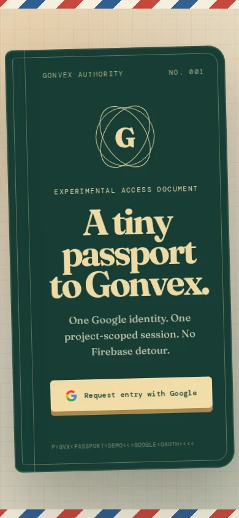

# Gonvex Passport demo

A small React + Vite app that tests end-to-end Google sign-in on [Gonvex](https://github.com/Whagons-International/gonvex), a Convex-style realtime backend with Go functions. You sign in with Google through the Gonvex auth broker and get a session scoped to this one project. The app then shows a passport page with your Google profile and calls the project's Go query and mutation over the Gonvex WebSocket client.

Deployed at https://gonvex-passport.gabrielmalek.com.

<p>
  
  
</p>

## What it shows

- **Google sign-in through Gonvex.** `gonvex/auth.tsx` was generated by `gonvex auth add google` and wraps `createGonvexAuth` from `@gonvex/react`. `gonvex.json` declares the Google provider, the allowed redirect URI and `signupMode: "personal"`.
- **Go backend functions.** `gonvex/schema.go` declares a tenant-scoped `messages` table with an index on `created_at`. `gonvex/messages.go` registers the `messages.list` query and the `messages.send` mutation.
- **Generated, typed client bindings.** The Gonvex CLI generates the files in `gonvex/_generated/` (API references, React hooks, table types and a manifest) from the Go files. Don't edit them by hand.
- **Deployment check.** `tests/deployment-smoke.mjs` loads the deployed page and checks that it serves Vite's built JavaScript with a JavaScript MIME type, not raw TypeScript source.

## Stack

React 19, Vite, TypeScript, `@gonvex/client` and `@gonvex/react`, and the `@gonvex/cli` dev tool. The production image is built in two stages (`node:22-alpine` builds the app, `nginx:1.27-alpine` serves it with an SPA fallback and immutable caching for `/assets/`).

## Development

```bash
npm install
npm run dev          # runs `gonvex dev -- vite`
```

`gonvex dev` watches `gonvex/*.go`, regenerates `gonvex/_generated/*`, syncs schema and function metadata to the runtime, and starts Vite. Other scripts:

| Script | What it does |
| --- | --- |
| `npm run build` | `tsc -b && vite build` |
| `npm run gonvex:once` | Regenerate the bindings once, without watching |
| `npm run gonvex:deploy` | `gonvex deploy --env production` |
| `npm run test:deployment` | Smoke-test a deployment (set `DEPLOYMENT_URL`, otherwise it tests the default deployment) |

## Configuration

These are environment variable names only. See `.env.example`.

- `VITE_GONVEX_WS_URL`: WebSocket URL of the Gonvex runtime (defaults to `ws://localhost:8080/ws`)
- `VITE_GONVEX_URL` / `VITE_GONVEX_RUNTIME_URL`: HTTP URL of the runtime, used by the auth flow
- `VITE_GONVEX_PROJECT_ID`: the Gonvex project ID
- `GONVEX_PROJECT_ID`, `GONVEX_RUNTIME_URL`, `GONVEX_PROJECT_KEY`, `GONVEX_DEPLOYMENT`: CLI settings

The `Dockerfile` bakes in default build arguments that point to the hosted Gonvex runtime used by the live demo.

## Status

This is a demo that proves the auth flow works. The message functions are stubs: `messages.list` always returns an empty list, and `messages.send` echoes back the message without saving it. So the "entry ledger" only proves that an authenticated call reaches the backend. It doesn't store notes yet.
